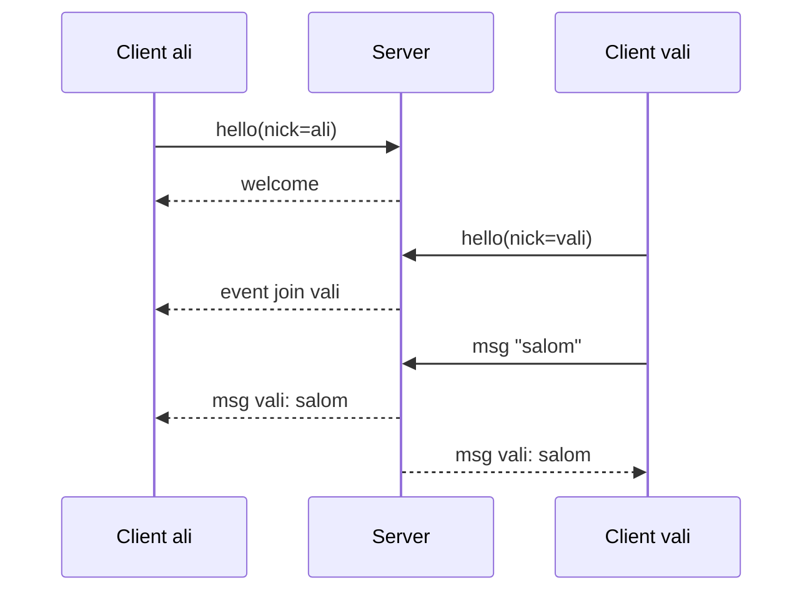

# Realtime Chat over TCP
[](https://github.com/damir126/realtime-chat/actions/workflows/ci.yml)

> **Course:** Computer Networks (3rd year)

A multi-room chat server and terminal client built directly on **TCP sockets** with Python `asyncio` —
no frameworks, no WebSockets. The project focuses on the problems that appear when you work with
raw sockets: message framing, concurrency, slow clients, and malicious input.

## Features

- Thousands of concurrent clients in **one thread** (asyncio event loop, non-blocking I/O)
- Rooms (`/join`), user list (`/who`), private messages (`/msg`), nickname change (`/nick`)
- Last 20 messages of a room are replayed to newcomers
- Per-client rate limiting (10 messages / 5 s)
- Defensive server: handshake timeout, maximum frame size, input validation

## Protocol

TCP delivers a **stream of bytes**, not messages: one `send()` may arrive in several pieces, and several
`send()`s may arrive together. Every message is therefore framed with a length prefix:

```
+--------------------+-----------------------------+
| length (4 bytes,   | payload: UTF-8 JSON object  |
| big-endian uint32) |                             |
+--------------------+-----------------------------+
```

```
client -> server   {"type": "hello", "nick": "ali"}
server -> client   {"type": "welcome", "nick": "ali", "room": "lobby", ...}
client -> server   {"type": "msg", "text": "salom!"}
server -> room     {"type": "msg", "nick": "ali", "room": "lobby", "text": "salom!", "ts": 1732350000.0}
server -> room     {"type": "event", "event": "join", "nick": "vali", "room": "lobby"}
```



## Run

```bash
python -m chat.server --port 9000          # terminal 1
python -m chat.client --nick ali           # terminal 2
python -m chat.client --nick vali          # terminal 3
```

```
connected as ali
* ali joined lobby
* vali joined lobby
14:02 [lobby] vali: salom!
/msg vali hi from ali
14:03 [pm] ali -> vali: hi from ali
```

To chat over a LAN, start the server with `--host 0.0.0.0` and connect clients with `--host <server-ip>`.

## Tests

```bash
python -m unittest discover -s tests -v
```

The tests start a real server on a random port and connect several clients. They check, among other things,
that **a frame split across packets and two frames merged into one packet** are both decoded correctly,
that rooms are isolated, and that a client announcing a 10 MB frame is disconnected instead of
making the server allocate memory.

## What I learned

- The difference between a byte stream and messages, and why framing is needed
- How `asyncio` serves many sockets in one thread, and what `drain()` (back-pressure) does
- Why a server must never trust its clients (timeouts, size limits, rate limits)
